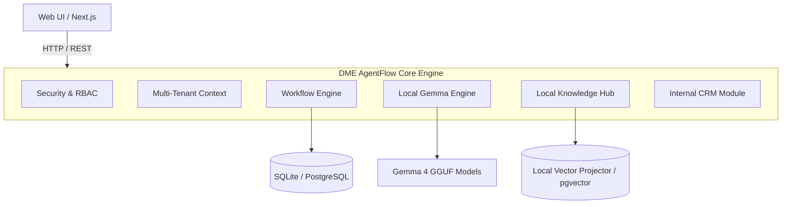

# DME AgentFlow — System Architecture Specification

## 1. Monolithic Modular Architecture

DME AgentFlow utilizes a **modular monolith** backend design. This avoids the networking, serialization, and distributed failure modes of microservices while providing strict internal module boundaries:

## 2. Security Boundaries & Multi-Tenancy

Every database entity derives from an organization tenant key `org_id`:
- Strict query scoping guarantees zero cross-tenant contamination.
- The `get_current_user_context` FastAPI dependency validates the signed JWT, confirms active membership, and injects the authenticated `org_id` directly into the database session.

## 3. Workflow Engine Execution Flow

1. **Trigger Reception**: Manual invocation, webhook ingestion, or form dispatch.
2. **Topological Evaluation**: The engine resolves execution dependencies across nodes.
3. **Context Evolution**: Each completed node updates the execution payload context.
4. **Human-in-the-Loop Pausing**: Upon encountering an `ApprovalNode`, execution pauses with state `WAITING_APPROVAL`.
5. **Resume on Decision**: An authorized approver posts an `APPROVE` or `REJECT` decision, immediately resuming execution along the corresponding conditional edge.
